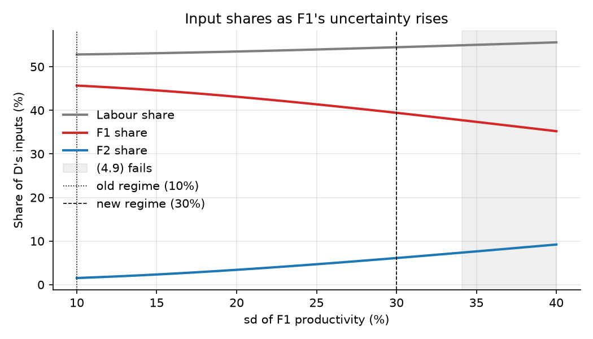
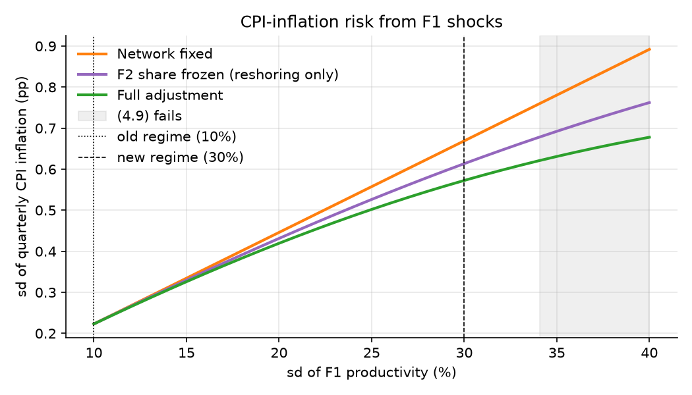
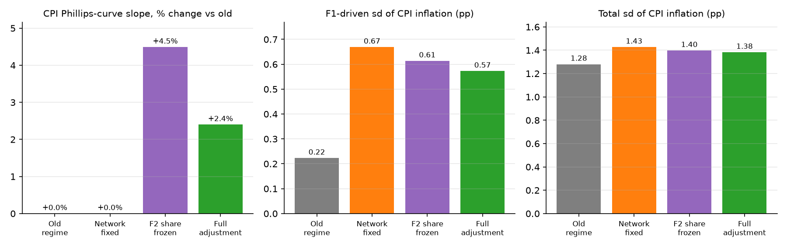
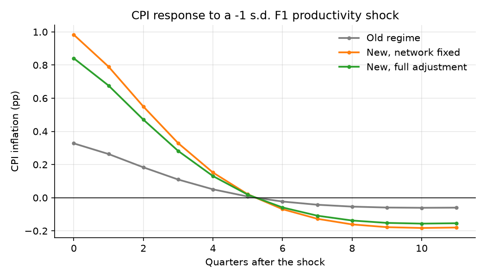
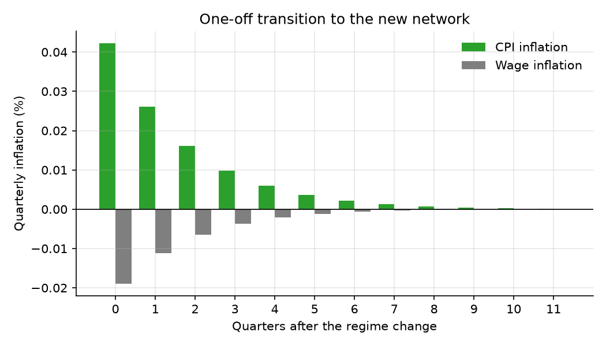
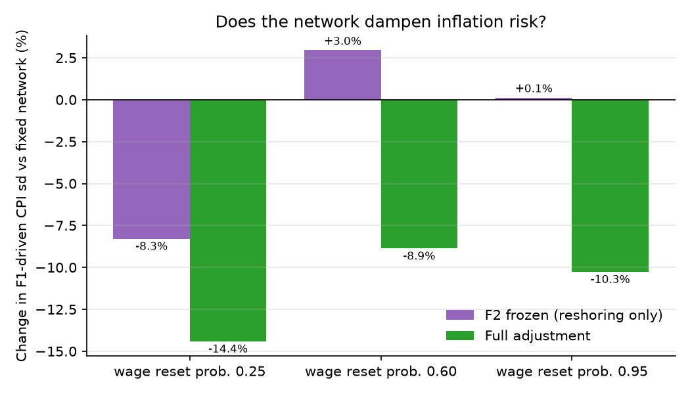

# Interior experiment: rise in F1's productivity variance with x1 >> x2 > 0

## 1. Calibration

**Parameters**

| Parameter | Value | Role |
|:---|---:|:---|
| Risk aversion gamma | 4.30 | KMNT calibrated value |
| Inverse Frisch phi | 1.00 |  |
| Risk weight Gamma, eq. (4.4) | 1.245 | (gamma-1)(1+phi)/(gamma+phi) |
| CES elasticity theta | 6.0 | enters only condition (4.9) |
| Discount factor rho | 0.99 | quarterly |
| TFP persistence eta | 0.90 | quarterly AR(1) |
| Calvo reset: wages / prices | 0.25 / 0.33 | M4: foreign = domestic prices |
| Hat deltas: wages / prices | 0.079 / 0.145 | eq. (5.13) |
| Ideal shares (labour, F1, F2) | 0.50 / 0.25 / 0.25 | T2, interior |
| Curvatures kappa (labour, F1, F2) | 1.00 / 0.35 / 0.35 | separable TFP shifter |
| Expected productivity mu (D, F1, F2) | 0.00 / 0.05 / -0.11 |  |
| sd of shocks: D / F2 | 10% / 10% | no cross-correlations |
| sd of F1 shock: old -> new | 10% -> 30% | variance x9 |

## 2. Network block

**Domestic sector's technique and aggregate TFP**

| Metric | Old regime | New regime | Change |
|:---|---:|---:|---:|
| Labour share x0 | 52.8% | 54.5% | +1.7 pp |
| F1 share x1 | 45.7% | 39.4% | -6.2 pp |
| F2 share x2 | 1.5% | 6.1% | +4.6 pp |
| F1's share of foreign inputs | 96.8% | 86.6% |  |
| Total foreign share s | 47.2% | 45.5% | -1.7 pp |
| E[z] (log points x100) | 0.364 | 0.211 | -0.154 |
| sd(z) | 11.0% | 15.5% | +41.0% |
| F1 contribution to V[z] | 0.00209 | 0.01399 |  |
| F2 contribution to V[z] | 0.000002 | 0.000037 |  |
| Planner objective W | -0.00388 | -0.01285 |  |

*Note: Each unit of share taken from F1 goes to F2 in the fixed fraction M12/M22 = 73.4%; the rest goes to labour.*

**Analytical checks (solver vs formulas)**

| Check | Solver | Formula | Abs. difference |
|:---|---:|---:|---:|
| New F1 share: solver vs closed form | 0.394214 | 0.394214 | 5.6e-17 |
| New F2 share: solver vs closed form | 0.061130 | 0.061130 | 3.5e-17 |
| New F1 share: solver vs Sherman-Morrison | 0.394214 | 0.394214 | 5.6e-17 |
| New F2 share: solver vs Sherman-Morrison | 0.061130 | 0.061130 | 2.1e-17 |
| Share of F1's loss going to F2 vs M12/M22 | 0.733970 | 0.733970 | 0.0e+00 |
| dx2/dSigma11: finite difference vs formula | 0.664179 | 0.664181 | 1.3e-06 |
| (4.10) fixed point, old regime (residual) | 0.000000 | 0.000000 | 5.6e-17 |
| (4.10) fixed point, new regime (residual) | 0.000000 | 0.000000 | 5.6e-17 |

## 3. Second-order condition (4.9)

**Unilateral deviations by a single producer**

| sd of F1 shock | Min eigenvalue (4.9) | Equilibrium (x0, x1, x2) | Best deviation | Gain | Verdict |
|:---|---:|---:|---:|---:|:---|
| 30% | +0.0802 | 0.545 / 0.394 / 0.061 | 0.545 / 0.395 / 0.060 | -1.1e-06 | equilibrium |
| 34% | +0.0017 | 0.549 / 0.378 / 0.073 | 0.550 / 0.375 / 0.075 | -4.0e-07 | equilibrium |
| 36% | -0.0427 | 0.551 / 0.369 / 0.079 | 0.635 / 0.000 / 0.365 | +2.3e-02 | deviation pays |
| 40% | -0.1430 | 0.556 / 0.352 / 0.092 | 0.635 / 0.000 / 0.365 | +6.8e-02 | deviation pays |

*Note: (4.9) holds for sd of F1 shock below 34.1%. Gains are in log value; tiny negatives reflect the grid.*

## 4. Phillips-curve objects

**Slopes, cost-push exposures and index weights**

| Object | Old regime | New, network fixed | New, F2 share frozen | New, full adjustment |
|:---|---:|---:|---:|---:|
| Foreign share s | 47.2% | 47.2% | 44.1% | 45.5% |
| Wage pass-through S | 0.5966 | 0.5966 | 0.6232 | 0.6108 |
| CPI slope (gamma+phi) kappa^C | 0.03657 | 0.03657 | 0.03821 | 0.03745 |
|   change vs old | +0.0% | +0.0% | +4.5% | +2.4% |
| DC slope | 0.2610 | 0.2610 | 0.2633 | 0.2622 |
| CPI exposure to D, v^C_D | -0.13940 | -0.13940 | -0.13914 | -0.13926 |
| CPI exposure to F1, v^C_F1 | -0.00656 | -0.00656 | -0.00598 | -0.00560 |
| CPI exposure to F2, v^C_F2 | -0.00022 | -0.00022 | -0.00021 | -0.00087 |
| DC index weight on F1 | 13.2% | 13.2% | 12.4% | 11.5% |
| DC index weight on F2 | 0.4% | 0.4% | 0.4% | 1.8% |

*Note: Under M4 both slopes depend on the network only through the foreign share s.*

## 5. Inflation risk under G1

**Standard deviation of quarterly CPI inflation (percentage points)**

| Component | Old regime | New, network fixed | New, F2 share frozen | New, full adjustment |
|:---|---:|---:|---:|---:|
| Driven by F1 shocks | 0.223 | 0.669 | 0.613 | 0.573 |
| Driven by F2 shocks | 0.007 | 0.007 | 0.007 | 0.030 |
| Driven by D shocks | 1.260 | 1.260 | 1.256 | 1.258 |
| Total | 1.280 | 1.427 | 1.398 | 1.382 |
| F1 share of CPI variance | 3.0% | 22.0% | 19.3% | 17.2% |
| Impact of a -1 s.d. F1 shock (pp) | 0.328 | 0.983 | 0.901 | 0.841 |

**How much of the new F1-driven inflation risk the network absorbs**

| Scenario | F1-driven sd | vs network fixed | Share of the rise absorbed |
|:---|---:|---:|---:|
| New, F2 share frozen | 0.613 | -8.3% | 12.4% |
| New, full adjustment | 0.573 | -14.4% | 21.6% |
| Contribution of diversification |  | -6.1 pp |  |

*Note: Benchmark: new shocks with the old network. Rise = fixed-network sd minus old-regime sd.*

## 6. One-off transition

**Adjustment to the new natural prices (network adopts immediately)**

| Metric | Value |
|:---|---:|
| Change in E[z] = change in natural real wage | -0.154% |
| Cumulative CPI inflation | +0.109% |
| Cumulative wage inflation | -0.045% |
| Check: cumulative (CPI - wage) = -change in E[z] | +0.154% |
| CPI inflation in the first quarter | +0.042% |
| Relative-price gap closed | yes |

## 7. Robustness to wage rigidity

**F1-driven CPI inflation sd under the new shocks (pp)**

| Wage reset prob. | v^C_F1 (old network) | Network fixed | F2 frozen | Full adjustment | Total CPI sd: full vs fixed |
|:---|---:|---:|---:|---:|---:|
| 0.25 | -0.00656 | 0.669 | 0.613 (-8.3%) | 0.573 (-14.4%) | -3.1% |
| 0.60 | +0.00957 | 0.429 | 0.441 (+3.0%) | 0.390 (-8.9%) | -3.0% |
| 0.95 | +0.03037 | 0.838 | 0.839 (+0.1%) | 0.752 (-10.3%) | -7.6% |

*Note: v^C_F1 > 0 means a bad F1 draw is deflationary (relatively flexible wages).*

## Charts

1. The slope of the Phillips curve increases, but less when the network can adjust, because of more intermediate input usage
2. Both diversification and reshoring reduce the impact of F1 in driving inflation and the overall "inflation risk"

1. deflation in the end, until price level is back at pre-shock levels (shock is transitory AR(1) so F1 productivity goes back to normal and also every other natural relative price)

Two channels: 
1. foreign rigidity (F1 price rises, this increases MC for D. CPI goes up)
2. wage rigidity (lower F1 productivity means lower aggregate TFP, lower natural wage, see figure above, cheaper labor lowers D's costs and pushed down CPI)
